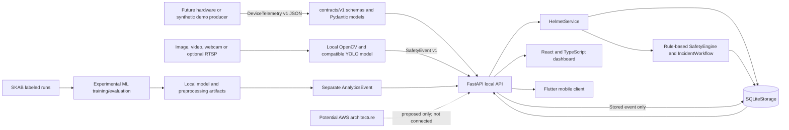
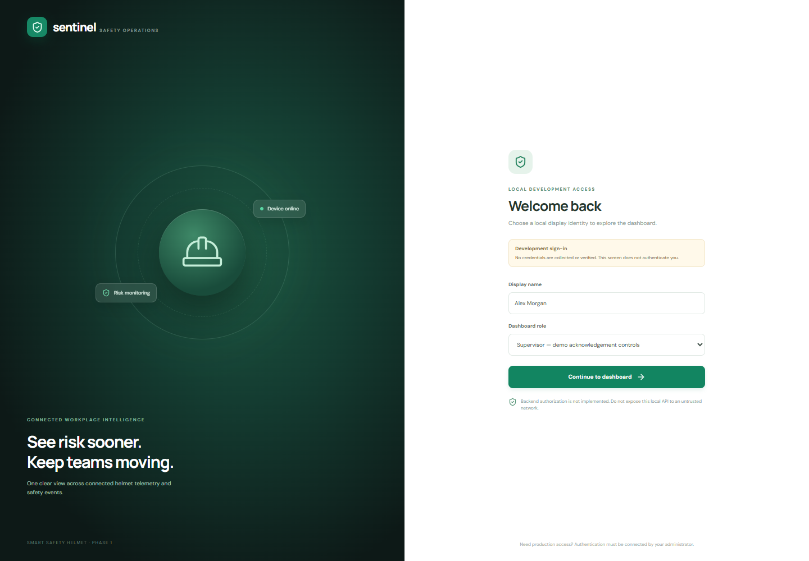
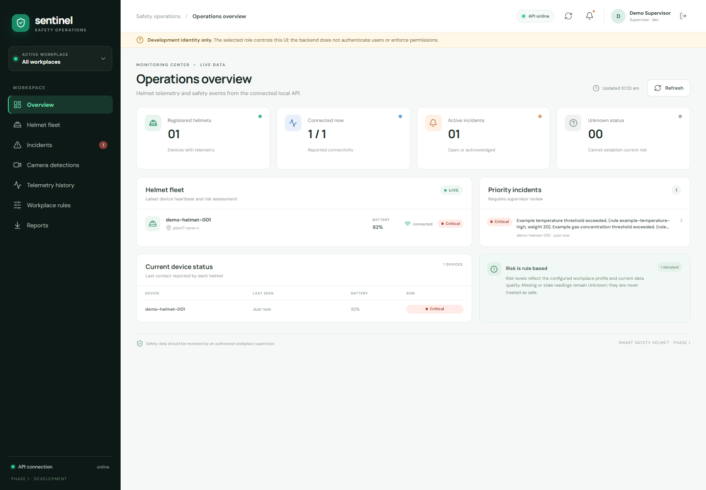
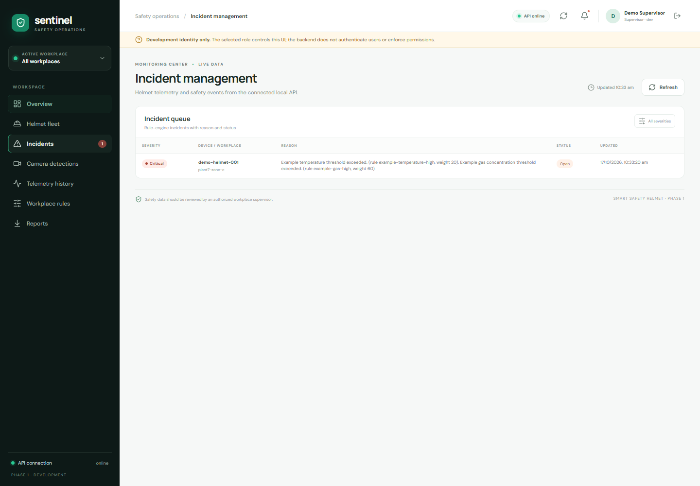

# AI-Based Multi-Industry Smart Safety Helmet
## Final-Year Project Report and Demonstration Guide

**Report date:** 17 October 2026  
**Status:** Software prototype; no physical helmet or industrial deployment has been verified.

> **Demonstration boundary:** All walkthrough data is synthetic. This academic prototype is not certified, validated, or authorized for industrial safety decisions. Keep demo data, devices, cameras, accounts, networks, and notifications separate from real operations. See [Demonstration and Industrial Deployment Boundary](demo-industrial-boundary.md).

## Abstract

This project implements a software prototype for a Smart Safety Helmet platform using a versioned data contract, a local FastAPI service, a configurable rule-based safety engine, incident storage, a React supervisor dashboard, and a Flutter mobile client. Optional computer-vision code processes images or video locally with OpenCV and compatible YOLO weights. An experimental machine-learning pipeline compares sensor anomaly detection methods on the public SKAB water-circulation testbed dataset. The backend stores validated telemetry and events in SQLite and generates incidents from rule-based telemetry evaluations. The dashboard retrieves status and incidents from that API.

The work demonstrates a software data path and repeatable test workflow. No ESP32 or other helmet hardware has sent real readings; no AWS resources, production identity provider, or notification provider are connected. Computer-vision results come from six labeled public test images. Machine-learning metrics describe SKAB process anomalies and do not predict helmet or worker safety. All results and performance measurements are software-prototype evidence only.

## 1. Problem statement

Safety monitoring may involve readings from multiple devices, data-quality concerns, incident review, and different user interfaces. This project explores a software design that gives those components a shared message format and explainable workflow. In particular, missing and stale readings should remain distinguishable from valid readings, and unknown data should not be treated as proof of safety.

This is the project framing, not a measured claim about a particular industrial site. The prototype does not replace certified PPE, approved safety systems, site procedures, or human supervision.

## 2. Objectives and scope

### Implemented objectives

- Define versioned JSON Schemas and Pydantic models for telemetry, sensor readings, device health, safety events, and incidents.
- Validate units, identifiers, UTC timestamps, explicit null/missing readings, ranges, and related fields.
- Persist telemetry, events, analytics events, and incidents in local SQLite.
- Evaluate telemetry with a hardware-independent, configurable weighted rule engine and preserve reasons and data-quality issues.
- Expose local FastAPI routes and generated OpenAPI documentation.
- Display actual backend data in a React/TypeScript dashboard and provide a Flutter client for the current API shape.
- Provide optional local CV and separate experimental ML modules with documented evaluation limits.
- Exercise the software with automated tests and a synthetic telemetry-to-dashboard demonstration.

### Scope and implementation status

| Area | Status |
| --- | --- |
| Physical helmet, sensors, ESP32 firmware, calibration | Not implemented or tested |
| Local backend and SQLite adapter | Implemented for development |
| AWS IoT, Lambda, DynamoDB, API Gateway, SNS | Architecture proposed only; no resources or IAM deployed |
| Local server-side login and role authorization | Implemented for local development with bootstrap accounts; production identity provider not integrated |
| Notification delivery | Not implemented |
| Certified safety thresholds or safety certification | Not provided |
| CV PPE sample evaluation | Six-image, two-class sample only |
| ML safety prediction | Not implemented; SKAB process anomaly benchmark only |

## 3. Requirements and technology selection

### Requirements addressed

- Use a shared versioned contract across API and future producers.
- Reject malformed messages; do not convert missing values to zero.
- Preserve `valid`, `missing`, `stale`, and `invalid` reading states.
- Return `Unknown` when a risk status cannot be established.
- Persist data and prevent duplicate telemetry/event IDs.
- Separate API routes, services/rules, and storage.
- Make dashboard data API-driven, with error and empty states.
- Keep CV/ML outputs separate from rule-based incident decisions.
- Run locally without AWS credentials or hardware.

### Technology choices

| Technology | Project use | Selection reason in this implementation |
| --- | --- | --- |
| Python 3.13 and Pydantic | Contract, backend, CV/ML integration | Shared typed models and Python services |
| FastAPI | Local REST API and OpenAPI | Request validation and generated API documentation |
| SQLite | Development persistence | File-backed local storage, no cloud account required |
| React, TypeScript, Vite, Zod | Supervisor dashboard | Browser UI with typed API response validation |
| Flutter/Dart | Mobile client | Cross-platform client consuming the existing API contracts |
| OpenCV DNN / optional Ultralytics YOLO | Local vision inference | Processes image/video on the host; PPE classes depend on selected weights |
| scikit-learn and joblib | Experimental anomaly analytics | Train and evaluate baseline and Isolation Forest separately |
| pytest, Vitest, Flutter tests | Automated verification | Application checks using synthetic fixtures |

These are implementation choices, not claims that the stack is certified or suitable for every industrial site.

## 4. Implemented system architecture



The local persistence adapter is SQLite. AWS is a proposal, not an active runtime path. ML analytics are separate from rule-based incidents. Camera `SafetyEvent` messages are stored as events and do not automatically create incidents.

## 5. Data flow and module descriptions

### Telemetry to rule-based incident

1. A producer forms `DeviceTelemetry` with stable device/workplace IDs, schema version, event ID, UTC times, readings, units, and device health.
2. FastAPI validates the request using the shared Pydantic contract.
3. `HelmetService` persists telemetry through the storage interface. SQLite uses the event ID as a primary key; duplicate IDs are rejected.
4. The route-independent safety engine checks the active workplace profile, thresholds, freshness, sensor states, connectivity, and required readings.
5. It returns `Normal`, `Advisory`, `Warning`, `Critical`, or `Unknown`, plus score, reasons, matched rules, and quality issue codes.
6. A non-Normal assessment creates or updates an incident; repeated matching triggers merge while active.
7. The dashboard reads fleet status, current risk, and incident history from the API.

### Camera event flow

Image, recorded video, webcam, or optional RTSP input is processed locally. The module emits only supported detector classes and configured person/zone findings, then converts relevant detections into a shared `SafetyEvent`. The backend stores that event; camera events do not create rule-engine incidents. Frames are not persisted by the pipeline by default.

### ML analytics flow

The experimental ML pipeline produces a separate `AnalyticsEvent`. The result does not modify the rule engine, create incidents, or establish that a workplace is safe. The selected dataset is SKAB, an instrumented water-loop testbed, not helmet telemetry.

### Main code areas

- `contracts/v1/`: schemas, models, examples, and schema export.
- `backend/app/api/`: API routers and response models.
- `backend/app/services.py`: application service orchestration.
- `backend/app/safety/`: workplace profile configuration, rule scoring, and incident lifecycle.
- `backend/app/storage/`: storage protocol and SQLite adapter.
- `computer_vision/`: local inputs, detector integration, tracking/zones, event conversion, evaluation.
- `machine_learning/`: data splitting, training, evaluation, predictor, and analytics event.
- `web-dashboard/`: API-driven supervisor dashboard.
- `mobile-app/`: Flutter client.
- `cloud/`: placeholder only; proposal in `docs/cloud-architecture-proposal.md`.

## 6. Shared data contract, database design, and API

The hardware-independent contract is documented in [data-contract-v1.md](data-contract-v1.md), and the schemas are copied to `docs/contracts/v1/schemas/` as a Phase 2 reference. IDs are stable opaque strings; timestamps include UTC. Missing readings use `value: null` and `reading_status: "missing"`; zero remains an ordinary measurement. The contract does not define industrial thresholds.

### SQLite schema

Implemented in `backend/app/storage/sqlite.py`:

| Table | Primary key | Data and indexes |
| --- | --- | --- |
| `telemetry` | `event_id` | Device/workplace IDs, observed time, JSON payload; index by device and descending observed time/event ID |
| `safety_events` | `event_id` | Device/workplace IDs, occurrence/report times, JSON payload; index by workplace and descending occurrence time/event ID |
| `analytics_events` | `analytics_event_id` | Device/workplace IDs, observation/generation times, JSON payload; index by workplace and descending observation time/event ID |
| `incidents` | `incident_id` | Device/workplace IDs, status, opened/updated times, dedupe key, JSON payload; indexes for update time and active deduplication |

Helmet summaries are derived from the latest telemetry; there is no separate helmet table. Storage has no configured retention/deletion lifecycle. SQLite is the only implemented adapter.

### API routes

FastAPI generates Swagger UI at `/docs` and OpenAPI at `/openapi.json`.

| Method | Route | Behavior |
| --- | --- | --- |
| GET | `/health` | API and local storage readiness |
| POST | `/api/v1/auth/login` | Exchange a bootstrap username/password for an expiring bearer token |
| POST / GET | `/api/v1/telemetry` | Accept validated telemetry / list history with pagination and filters |
| GET | `/api/v1/helmets` | Paginated latest device summaries |
| GET | `/api/v1/helmets/{helmet_id}` | Device summary and latest telemetry |
| GET | `/api/v1/helmets/{helmet_id}/risk` | Current configured rule evaluation |
| GET | `/api/v1/workplaces/profiles` | List configured workplace profiles |
| PUT | `/api/v1/workplaces/profiles/{workplace_id}` | Administrator-only validated profile replacement |
| POST / GET | `/api/v1/events` | Store/list safety events, including CV events |
| POST / GET | `/api/v1/analytics/events` | Store/list separate ML analytics events |
| GET | `/api/v1/incidents` | Paginated incident list |
| GET | `/api/v1/incidents/{incident_id}` | Incident details |
| GET | `/api/v1/incidents/{incident_id}/history` | Incident history entries |
| POST | `/api/v1/incidents/{incident_id}/acknowledge` | Record acknowledgement actor/time |

Invalid bodies return `422`, duplicate IDs return `409`, unknown resources return `404`, and storage failures use generic server errors. Lists have bounded limits and pagination. **Data routes require bearer authentication and enforce role permissions.** Local bootstrap authentication is not production identity management; do not expose this API to an untrusted network.

## 7. Rule-based safety engine and incidents

The engine in `backend/app/safety/` is a weighted rule system, not machine learning. A workplace profile defines measurements, units, operators, development thresholds, weights, score bands, freshness requirements, and optional escalation steps. Matched weights are summed, and the resulting level is the higher of the score band or an individual rule's minimum risk.

Risk levels are `Normal`, `Advisory`, `Warning`, `Critical`, and `Unknown`. Missing, stale, invalid, unavailable, or inconsistent data is surfaced in reasons and quality issue codes. Uncertainty cannot produce `Normal`. A non-Normal assessment creates or updates an incident; repeated matching device/workplace/rule/quality signatures merge while active. Escalation targets are recorded, but no notification is sent. Development rules are not certified industrial limits.

## 8. Computer-vision approach and measured evaluation

The optional CV module uses OpenCV for image/video input and compatible YOLO weights. It can process an image, recorded video, webcam, or optional RTSP source on a laptop/edge host. It does not assume ESP32-CAM can run YOLO inference. Supported classes depend on the selected model. The reported evaluation was explicitly limited to `Hardhat` and `NO-Hardhat`; it makes no claim for other PPE, fire, smoke, falls, fatigue, or compliance.

Detailed provenance, license review, missed box and commands are in [computer-vision-evaluation.md](testing/computer-vision-evaluation.md). Six images came from the test split of the CC BY 4.0 Hard Hat dataset; the model was a pinned CC BY 4.0 YOLOv8m ONNX checkpoint. Images remained in ignored local folders.

| Evaluation | Images / labeled boxes | TP | FP | FN | Precision | Recall | IoU |
| --- | ---: | ---: | ---: | ---: | ---: | ---: | ---: |
| OpenCV DNN, pinned ONNX model, confidence 0.25 | 6 / 20 | 19 | 0 | 1 | 1.00 | 0.95 | 0.50 |

One `Hardhat` box was missed in image 449. Zero false positives across six selected images does not establish a low operational false-positive rate. A 17 October 2026 run measured mean inference of 561.41 ms/image; an earlier run on the same subset reported 482.90 ms/image. The run-to-run difference is retained. A repeated-image microbenchmark used a different timing method and is described in the [Task 12 review](security-deployment-performance-review-draft.md). None of the figures is a physical camera or deployment result.

## 9. AI/ML methodology, dataset, and results

The selected task is binary anomaly classification for labeled multivariate process rows. Dataset: SKAB v0.9, 34 water-circulation testbed runs, source revision `b2c0d46c2971dcbfe71e26087b6d231998bb91c2`, GPL-3.0. Whole runs are assigned to train/validation/test (20/7/7); no run crosses partitions. Eight channels are fitted using normal training rows only. The robust z-score baseline and Isolation Forest are compared. Thresholds are selected on validation F1, and held-out test runs are evaluated once. See [ML evaluation readiness](testing/ml-evaluation-readiness.md) for provenance and reproduction.

| Model | TP | FP | TN | FN | Precision | Recall | F1 | False-positive rate |
| --- | ---: | ---: | ---: | ---: | ---: | ---: | ---: | ---: |
| Robust z-score baseline | 2,295 | 3,124 | 1,842 | 234 | 0.4235 | 0.9075 | **0.5775** | 0.6291 |
| Isolation Forest | 2,333 | 3,498 | 1,468 | 196 | 0.4001 | **0.9225** | 0.7044 |

Isolation Forest missed 196 labeled anomaly rows and flagged 3,498 normal rows. It had higher recall but worse F1 and more false alarms than the baseline on this split. It describes SKAB water-loop anomalies; it does not predict helmet risk, heat stress, fatigue, falls, gas exposure, PPE compliance, or worker injury. Its `AnalyticsEvent` does not create incidents.

## 10. Test cases and results

Tests use synthetic records and temporary storage unless noted. They are not physical-device tests.

| Area | Latest result | Evidence/command |
| --- | --- | --- |
| Contract/backend: valid and invalid telemetry, missing/stale/malformed readings, duplicates, unknown IDs, storage failures, risk rules, incident workflow/history, pagination | 74 passed | `.\.venv\Scripts\python.exe -m pytest -q` |
| Dashboard component/API tests and browser fetch-context regression | 9 passed, 1 live-only test skipped in default run | `npm test -- --run` in `web-dashboard/` |
| Live telemetry-to-dashboard integration | 1 passed | `tests/run-live-dashboard-e2e.ps1`; synthetic POST to temporary FastAPI/SQLite, then React reads and renders risk/incident |
| Dashboard bundle | Passed | `npm run build` |
| Flutter app logic/widgets/API/session | 19 passed | `flutter test` in `mobile-app/` |
| Actual local browser walkthrough | Passed | `tests/start-demo.ps1`; Edge screenshot shows API online, synthetic device, Critical risk and incident reason |
| Python dependency consistency | Passed | `python -m pip check` |

### Reproducible local performance evidence

Methods and limitations are in the Task 12 review. Summary:

- API: 100 sequential in-process TestClient synthetic telemetry POSTs across ten IDs, each followed by a risk GET. POST mean 15.029 ms, p50 14.388 ms, p95 17.163 ms, max 64.889 ms. Risk GET mean 5.145 ms, p50 4.925 ms, p95 5.535 ms, max 18.175 ms. This is not socket latency, concurrent capacity, or production throughput.
- ML: 1,000 calls over held-out SKAB rows after ten warm-ups; includes validation, scaling, scoring, and event construction. Mean 9.125 ms, p50 9.050 ms, p95 9.602 ms, max 15.526 ms on this host. Not helmet-safety inference.
- CV: six-image evaluation timing above and separate microbenchmark in Task 12. Not camera-stream FPS or site performance.

## 11. Screenshots of the real application

Screenshots were captured from the running local React application in Microsoft Edge. The overview uses live API reads from the temporary demo SQLite database created by `tests/start-demo.ps1`; it is not a mock dashboard or illustration. The identifiers and readings are synthetic.

The latest clean-start captures and browser assertions are recorded in [demo-verification-2026-10-17.md](testing/demo-verification-2026-10-17.md).



*Figure 1. Historical screenshot of the pre-authentication development identity screen; it is not the current sign-in flow.*



*Figure 2. Live local dashboard after synthetic telemetry was posted. The Critical level and incident came from the local rule engine; example thresholds are not operational limits.*



*Figure 3. Incident management view for the same synthetic telemetry workflow.*

## 12. Deployment and user instructions

The supported deployment is a local Windows demonstration. There is no production/cloud deployment recipe. Follow the [root README](../README.md), install Python requirements and dashboard packages, and keep AWS optional.

### Start a complete isolated demo

From PowerShell at the repository root:

```powershell
.\.venv\Scripts\python.exe -m pip install -r requirements.txt -r requirements-dev.txt
Set-Location .\web-dashboard
npm ci
Set-Location ..
.\tests\start-demo.ps1 -ApiPort 8012 -DashboardPort 5173
```

The script creates a unique SQLite file under `%TEMP%`, loads the labeled example profile, submits one synthetic telemetry message with example elevated readings, checks for `Critical`, and starts the dashboard against the temporary API. It fails when selected ports are busy.

1. Open the printed dashboard URL.
2. Sign in with the temporary `demo-supervisor` credentials printed by `tests/start-demo.ps1`.
3. Confirm API online, `demo-helmet-001`, `Critical`, and the incident explanation are visible.
4. Open **Incidents** to inspect stored incident details/history.
5. Open `/docs` on the printed API URL to view OpenAPI routes.
6. Stop the demo with the printed session file:

```powershell
.\tests\stop-demo.ps1 -SessionFile "$env:TEMP\smart-helmet-demo-<session-id>\session.json"
```

Stopping preserves logs and SQLite data as evidence; remove the temporary folder manually only after reviewing it. The demo sign-in is not authentication. Its Supervisor label and acknowledgement control are not authorization.

More detail: [backend API](backend-local-api.md), [dashboard](../web-dashboard/README.md), [mobile](../mobile-app/README.md), [CV](../computer-vision/README.md), and [ML](../machine-learning/README.md).

## 13. Security, privacy, and safety considerations

- The backend enforces local bearer authentication and roles. Bootstrap account lifecycle, token revocation, production identity federation, and rate limiting remain unimplemented.
- Local CORS is restricted to development origins but does not protect routes. Keep the API loopback-only.
- SQLite records have no configured TTL/deletion; define retention and backup handling before collecting real data.
- Request logs include route template, method, status, request ID, and duration, not payloads or device IDs.
- CV processes frames in memory and does not save/stream footage by default. Process only permitted footage. RTSP credentials in command arguments may be visible to local processes.
- Protect datasets/model files and meet license/attribution terms. Load trusted joblib artifacts only.
- Missing, stale, invalid, or unavailable readings are not safety clearance. `Unknown` is not safe.
- Thresholds are development values. YOLO may miss detections or produce false alarms; human review is required.
- AWS/IAM, TLS ingress, rate limits, backup/recovery, production monitoring, notifications, and production identity federation are not implemented.
- See [demo/industrial boundary](demo-industrial-boundary.md) before considering any pilot.

## 14. Known limitations and future work

### Known limitations

- No physical helmet, sensor, calibration, embedded transport, or device authentication has been tested.
- No server identity or role authorization; no real login provider.
- AWS architecture is proposed but absent from runtime; no real cloud path, cost measurement, or IAM review.
- SQLite has no configured retention, encryption, or production backup lifecycle.
- CV uses only six images and missed one labeled box; no site/camera validation or reliable false-positive estimate.
- SKAB is unrelated to helmet hardware; the ML model has a high false-positive rate and is not safety-decision logic.
- Camera events are stored but do not automatically create incidents.
- Push notifications and provider authentication are not configured in mobile.
- Dashboard reports export a current fleet snapshot, not compliance reports.

### Future work

1. Build a hardware adapter against the v1 contract and bench-test synthetic and instrumented readings.
2. Review requirements with qualified stakeholders, calibrate sensors, and independently approve operational rules before a pilot.
3. Implement server identity/authorization, TLS, secrets, auditing, request limits, retention, backup/restore, and monitoring.
4. Develop a separate cloud deployment with concrete policies, cost review, staging, integration tests, and verified teardown.
5. Collect permissioned representative CV/telemetry data; evaluate on held-out devices/sites with misses and false alarms.
6. Add notifications only after identity, escalation ownership, provider setup, and failure behavior are tested.
7. Add retention/deletion workflows, camera access policy, worker privacy review, and mobile push integration.

## 15. Phase 2 hardware integration plan

1. Select sensors/controller after a requirements and hazard review; record calibration, accuracy, sampling, and environmental constraints.
2. Map each measurement to `measurement_type` and documented `unit_code`; convert before transmission and never encode absent values as zero.
3. Allocate stable device, sensor, and workplace IDs. Use UTC times and explicit reading quality states.
4. Validate captured bench messages against the JSON Schema/Pydantic contract before connecting to the API.
5. Use a private lab network and add device authentication, encryption, retry/backoff, event IDs, and offline buffering before device trials.
6. Test disconnected, stale, invalid, duplicate, clock-skew, low-battery, and recovery behavior. Confirm uncertainty stays `Unknown` and incidents are explainable.
7. Keep inference on laptop/edge/cloud unless measured capability supports a different placement; do not assume ESP32-CAM can execute the selected YOLO model.
8. Obtain qualified safety, security, and privacy review. A hardware prototype or bench test is not certification or deployment approval.

## References and project evidence

- [Data contract](data-contract-v1.md) and [Phase 2 hardware integration reference](hardware-integration-v1.md).
- [Local API](backend-local-api.md), [rule-based engine](rule-based-safety-engine.md).
- [Cloud proposal](cloud-architecture-proposal.md) and [AWS cost review](aws-account-setup-and-cost-review.md); proposal only.
- [CV dataset/model license and evaluation](testing/computer-vision-evaluation.md); [CC BY 4.0](https://creativecommons.org/licenses/by/4.0/).
- [SKAB provenance and metrics](testing/ml-evaluation-readiness.md); [SKAB source](https://github.com/waico/SKAB), GPL-3.0 at reviewed revision.
- [Task 12 security/performance review](security-deployment-performance-review-draft.md).
- [Task 11 integration review](testing/task-11-integration-review-draft.md).
